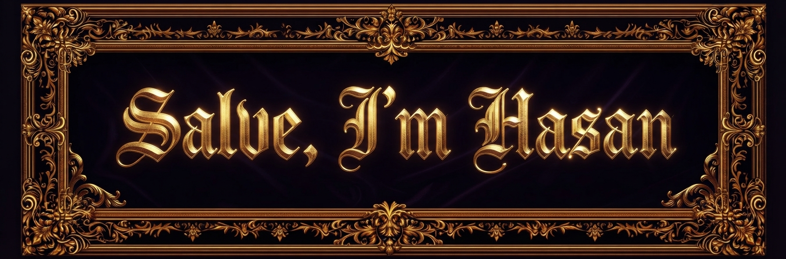
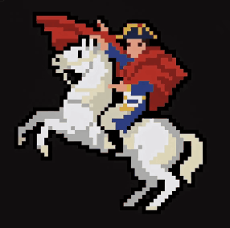

<!-- ÜST BANNER -->

  

<h3 align="center">⚜️ Computer Engineering Student & Developer ⚜️</h3>

  <i>"Impossible is a word to be found only in the dictionary of fools."</i>

<!-- SAĞDA 8-BIT PIXEL ART NAPOLYON GIF'İ, SOLDA HAKKIMDA KISMI -->

### ⚔️ About Me

- 🎓 Studying **Computer Engineering** at **Gazi University**
- 💻 Building projects with **Python** & **Embedded Systems (Arduino)**
- 🎨 Passionate about **Visual Art, Digital Composition & Game Aesthetics**
- ⚡ Currently working on hardware-software integration like **ArduinoRadarProject**

 

### 🛠️ Tech Arsenal

  
  
  
  

 

<!-- ALT İSTATİSTİKLER: ALTIN & SİYAH TEMALI -->

  

